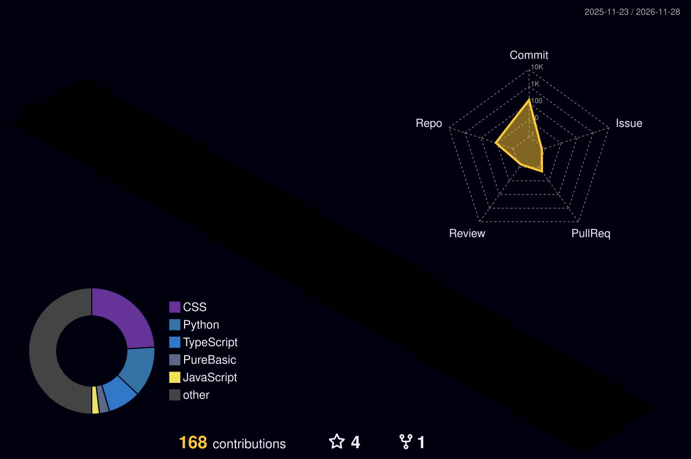

  

## 👋 Olá, eu sou Luiz Henrique!

**Desenvolvedor de Software · Sócio da Shield-ACK · Apoio Educacional & TI na UNIMAR EAD · Estudante de ADS**
📍 Marília - SP | Brasil

Construo aplicações web de ponta a ponta e projetos de **visão computacional**, **automação com IA** e **segurança web**. Gosto de tirar a ideia do papel e colocar no ar, seja um site institucional em produção ou um robô goleiro que defende bolas com YOLOv8.

Fora do código, ensino e movimento a comunidade: sou **co-fundador e co-host do CodeCast**, podcast sobre o lado humano de quem trabalha com tecnologia, e instrutor em bootcamps e eventos de programação.

---

## 🛠 Stack

**Frontend**

**Backend & Dados**

**IA, Visão Computacional & Automação**

**Infra & Ferramentas**

---

## 🚀 Projetos em destaque

| Projeto | O que é | Stack | Links |
|---|---|---|---|
| ⚽ **Robô Goleiro** | Robô autônomo que detecta a bola em tempo real e aciona um motor DC 24V para defender | Python · YOLOv8 · ONNX · Arduino | [Repo](https://github.com/lorocks51987/Goleiro-OpenCV) |
| 🛡️ **SecWebScan Pro** | Plataforma de auditoria automatizada de segurança web (DAST + OSINT) com relatório por IA | n8n · APIs · Dashboard | [Repo](https://github.com/lorocks51987/n8n-SecWebScan) |
| 🏛️ **Instituto Vozes Fortes** | Site institucional em produção | React · TypeScript · Tailwind | [Site](https://vozesfortes.com.br/) · [Repo](https://github.com/lorocks51987/vozesFortes) |
| 🎙️ **CodeCast** | Landing page do podcast com métricas da API do YouTube | React · TypeScript · Tailwind | [Site](https://code-cast-two.vercel.app) · [Repo](https://github.com/lorocks51987/CodeCast) |
| 🧥 **SubVerse** | Loja/vitrine de uma marca de streetwear underground | React · TypeScript | [Site](https://sub-verse-delta.vercel.app) · [Repo](https://github.com/lorocks51987/SubVerse) |
| 🐍 **SnakeDonuts** | Jogo arcade controlado pela ponta do dedo via webcam | Python · OpenCV | [Repo](https://github.com/lorocks51987/SnakeDonuts) |

📚 Mais projetos

- 🤖 **[J.A.R.V.I.S.](https://github.com/lorocks51987/Jarvis)**: assistente pessoal por voz com n8n e ElevenLabs ([demo](https://jarvis-lorocks.vercel.app/))
- 🎮 **[Stand de Visão Computacional](https://github.com/lorocks51987/Opencv)**: 4 projetos interativos criados para a UNIMAR Aberta (Libras, pintor virtual, contador e mais)
- 🧬 **[BioGen](https://github.com/lorocks51987/BioGen-Redes-ADS-6-A)**: projeto de rede corporativa segura no Packet Tracer (Redes, ADS)
- 💅 **[Isabela Nails](https://isabela-nails.vercel.app)**: site para um estúdio de unhas
- 🗺️ **[Unimap](https://github.com/lorocks51987/Unimap)**: mapa interativo da UNIMAR (competição universitária)

---

## 💼 Experiência & conquistas

- 🛡️ **Sócio da Shield-ACK**: conhecimento que protege
- 🏫 **Apoio Educacional e TI na UNIMAR EAD**
- 🎙️ **Co-fundador e co-host do CodeCast**: trajetórias de profissionais de tecnologia
- 👨‍🏫 **Instrutor em bootcamps e eventos**: HTML, CSS, JavaScript e Python
- 🥈 **Bootcamp Jovem Programador (UNIMAR)**: 2º lugar

---

## 📊 Atividade

---

## 🌐 Contato

> 💡 Aberto a projetos, freelas e troca de conhecimento. Chama no LinkedIn ou por e-mail!
